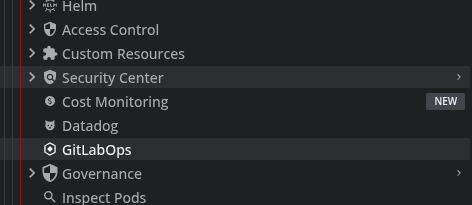
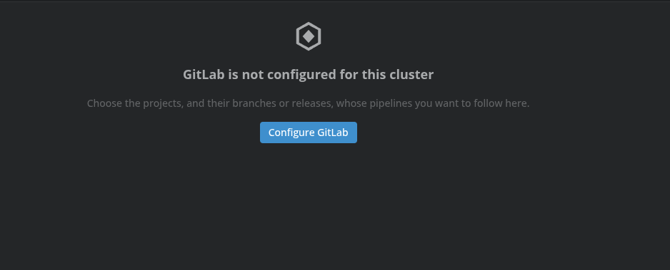
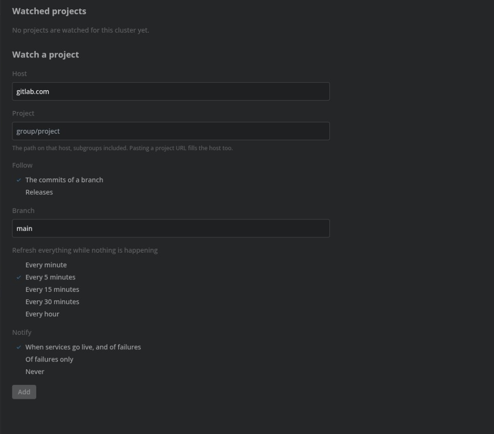

# GitLabOps for Lens

Keep an eye on the GitLab CI pipelines behind each of your clusters, without leaving Lens.

## Features

- A **GitLabOps** item under every cluster in the navigator, opening that cluster's dashboard of the latest commits or releases of each watched project, with the status of their pipelines and whether the cluster already runs them.

- An item in the status bar saying how the cluster you are looking at, or looked at last, stands: **Up to date**, **Behind**, **Deploying**, **Failing** or **Unreachable**, with the reason on hover. Click it to open the cluster's dashboard. It shows only for a cluster something is watched for. While it shows, it keeps that cluster's GitLab checks and cluster watches running, even with the dashboard closed.
- Notifications in Lens when services go live on a newer version, CI fails on the latest commit or release, something fails to apply, or the cluster or GitLab cannot be read, each with a link to the cluster's dashboard. Only changes notify: what already was when Lens started does not. They come from the clusters followed, those whose dashboard is open or the status bar item shows. Each watch can notify of everything, of failures only, or not at all.
- **GitLabOps settings** in every cluster's right-click menu, where each cluster gets its own list of watched GitLab projects, each following a branch's commits or the project's releases, and how often to check it.
- A row at the top of the dashboard, one card per watched project, saying whether the latest merge request into the branch it follows passed. When that pipeline failed, the card links to the repository.
- An **Ask AI** terminal at the bottom of the dashboard, folded until it is opened, where a project is watched by saying so. Any Ask AI conversation can also ask how the cluster stands, what a project's pipelines are, and to open the dashboard or the settings.

## Usage

Expand a cluster in the navigator and click **GitLabOps** to open its dashboard. If nothing is set up for the cluster yet, click **Configure GitLabOps** there, or right-click the cluster and choose **GitLabOps settings**.

In the settings, set the **host** (`gitlab.com`, or the host of a GitLab you run yourself) and the project as `group/project`, subgroups included (`group/team/app`). Pasting a project URL fills both.

Choose what to follow: **the commits of a branch** (`main` by default), for clusters that deploy every commit, or **releases**, with or without pre-releases such as release candidates, for clusters that deploy tagged releases. A pre-release is a tag GitLab users usually treat as one: it contains `rc`, `alpha`, `beta`, `pre`, or a semver suffix such as `-rc.1`. An optional tag pattern keeps only the releases whose tag matches, where `*` stands for anything: `v*` for a project that also releases other things under tags such as `artifact-contract/v0.2.0`. Pick how often to refresh everything while nothing is happening, and click **Add**. Watched projects show on the dashboard. Use **Edit** to change a project's branch or check interval, and **Remove** to stop watching it. Each cluster's list is kept across restarts of Lens.

The dashboard opens with a banner saying how the cluster stands: **Up to date**, **Behind**, **Deploying**, or **Failing** when CI fails on a branch's latest commit or Flux fails to apply a service. Under the banner, one card per watched project says whether the latest merge request into its branch passed. A failed one has a link to the repository. At the bottom, **Ask AI** stays folded until it is opened; from there a project is watched by saying so, for example "watch group/app on main", and a watch is changed or stopped the same way. Below the cards, for each watched project:

- **Cards** for how many services run the latest commit, how many versions are running, and how many recent commits pass their pipelines.
- **Services**: a table of every service the cluster runs from a build of the last 30 commits or releases, named after its image (such as `checkout-api`), with the version it runs and how many commits or releases behind the latest it is. Its **Deployed by** column names the Kustomization, HelmRelease or Argo CD Application that applies it, with its status and, for a HelmRelease, the chart version installed. When Flux has a newer chart, the status says so while it waits to install, is installing, or failed to install. When Flux image automation has picked up a newer build, the status follows it through Flux: **selected** by an ImagePolicy, **committed** to the GitOps repository by an ImageUpdateAutomation, **applying**, or **failed to apply**, then **rolling out**. Hover a service to see its workloads and what deploys them. Click a service to open its workload's details, and what deploys it to open its details.
- **GitOps syncs**, for a branch a Flux GitRepository or an Argo CD Application of the cluster follows: a table of the Kustomizations and Applications applying it, with the commit each applied and a newer one on its way, fetched, being applied, or failed to apply (the message on hover). This is what a GitOps repository, which deploys manifests rather than images, is followed by: watch it like any branch. The host in the Git remote has to be the host of the watch, so `gitlab.com/group/app` is not taken for the same project on a GitLab you host yourself.
- **Recent commits** or **Recent releases**: a table of the five latest, each with its message, its pipeline results (only the pipelines it started count: a merge request pipeline, a security scan or a DAST run recorded against the same commit is listed apart and counts for nothing; for a release with no pipelines of its own, as when a project builds on its default branch and tags afterwards, those of the commit it was tagged on, marked "on main") and the services of the cluster that run its build. Click a commit id or tag, or its pipeline results, to open its details in a panel that slides in over the dashboard: its message, author and date, with a link to GitLab; the services, Kustomizations and Argo CD Applications of the cluster at it; and its pipelines, each a card with a timeline of its jobs, how long each took and, for a failed one, why it failed, with links to the pipeline and to each job, and to re-run a failed pipeline's failed jobs, after confirming (this needs the GitLab CLI's account to be allowed to retry pipelines). Successful pipelines start folded. **Open in a tab** in the panel keeps the pipelines open in a tab of their own, next to the dashboard, with the end of a failed job's trace, errors and warnings marked; it goes on updating a pipeline in progress and comes back after Lens restarts.

For a branch, a service is recognised by the commit id, in full or abbreviated to at least 7 characters, in its image's tag, as in `backend:main-76cd335`. For releases, by its image's tag being the release's tag, with or without a leading `v`, as in `backend:v2026.9.3-rc.1`. The cluster's Deployments, StatefulSets and DaemonSets are read, and Flux's Kustomizations, HelmReleases, ImagePolicies and ImageUpdateAutomations and Argo CD's Applications when the cluster has them. Opening the dashboard connects Lens to the cluster. If the cluster cannot be read, for instance while its connection is down, the dashboard says so and tries again every 30 seconds.

While the dashboard is open, the cluster is followed live, and GitLab is checked as often as there is something to see. While pipelines are unfinished, or a service is on its way through Flux or rolling out, it checks every 15 seconds (**live** in the header). Otherwise it checks once a minute whether a new commit has landed, and refreshes everything at the project's check interval. If GitLab's rate limit is reached, it waits for the check interval before trying again. The refresh button checks right away.

## Requirements

The pipelines are read with the [GitLab CLI](https://gitlab.com/gitlab-org/cli) (`glab`). Install it and sign in with `glab auth login` before using the dashboard. For a GitLab you host yourself, sign in to that host (`glab auth login --hostname gitlab.example.com`) and set the same host on the watch.

When reading GitLab fails, the dashboard says why and what to do: glab not installed or not found by Lens (restart Lens after installing it, so it picks up your shell's PATH), not signed in or its sign-in expired, a group requiring single sign-on, a project or branch not found, GitLab's rate limit, or GitLab not reachable. For what needs you to act, checking pauses until you check again with the refresh button.

What changed in each version is in [CHANGELOG.md](./CHANGELOG.md).

## Ask AI

From any Ask AI conversation you can ask how this cluster stands and which projects are watched, what the latest pipelines of a watched project are, and to open this cluster's GitLabOps dashboard or its GitLabOps settings.

On the GitLabOps dashboard, open **Ask AI** at the bottom to watch a project, change what it follows, or stop watching it. Say "watch group/app on main" instead of filling in the form.

## Install

[Open lens-gitlab in Lens](https://app.k8slens.dev/lens-launcher?c=lens%3A%2F%2Fapp%2Fopen%2Fextension%3Fname%3Dlens-gitlab) and click Install there. The link offers Lens for download when it is not installed yet.
